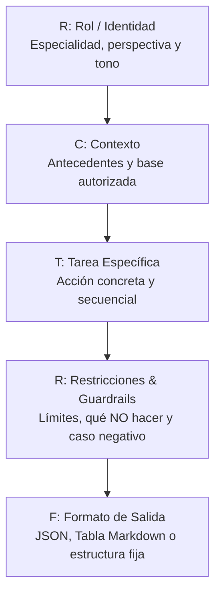

# GUÍA DIDÁCTICA DE CLASE: SUBINDICADOR 4 (SESIÓN 1 DE 2)
## Curso: Automatización de Agentes de IA (Pachaqtec / IDAT)

---

### FICHA TÉCNICA
* **Módulo / Unidad:** IL 2 - Diseño e Implementación de un Agente de IA
* **Subindicador Evaluado:** **4. Diseña prompts efectivos para el funcionamiento de agentes de IA en tareas específicas.**
* **Sesión:** Clase 1 de 2 del Subindicador 4 (Martes)
* **Horario:** Martes, 19:30 a 21:45 hrs (Duración: 135 minutos / 2h 15 min)
* **Tema de Hoy:** Anatomía del Prompt (Fórmula R-C-T-R-F), Delimitadores Semánticos, Grounding y Few-Shot Prompting en OpenAI Platform.
* **Tema del Jueves (Sesión 2):** Chain-of-Thought (Razonamiento Paso a Paso), Blindaje Anti-Inyección (Hardening), Optimización de Tokens y Evaluación Sistemática.

---

## 1. CRONOGRAMA MINUTO A MINUTO (19:30 - 21:45)

| Horario | Duración | Bloque | Actividad Pedagógica y Metodología |
| :--- | :---: | :--- | :--- |
| **19:30 - 19:45** | 15 min | **Apertura & Contexto** | • Bienvenida y asistencia.<br>• El prompt como "código fuente" de los agentes.<br>• Presentación de la hoja de ruta de las 2 clases del Subindicador 4. |
| **19:45 - 20:15** | 30 min | **Marco Conceptual (R-C-T-R-F)** | • Los 5 componentes esenciales: Rol, Contexto, Tarea, Restricciones y Formato.<br>• Delimitadores (Markdown `###` y XML `<tags>`).<br>• Zero-Shot vs Few-Shot Prompting. |
| **20:15 - 20:25** | 10 min | **Setup de Playground & Few-Shot** | • Dónde ubicar los ejemplos en OpenAI Playground (System Prompt vs mensajes previos).<br>• Calibración de Temperature según el objetivo. |
| **20:25 - 20:30** | 5 min | **Pausa Activa / Sincronización** | • Verificación de acceso a `platform.openai.com/playground` para todos los alumnos. |
| **20:30 - 21:20** | 50 min | **Laboratorio Hands-On (4 Prácticas)** | • Práctica 1: Deconstrucción de un mal prompt (Calificador de Leads B2B).<br>• Práctica 2: Base de conocimiento delimitada y control del caso negativo (RRHH).<br>• Práctica 3: Few-Shot para catálogo sucio de e-commerce.<br>• Práctica 4: Auditor de calidad de soporte con puntuación objetiva (QA). |
| **21:20 - 21:35** | 15 min | **Reto Aplicado en Vivo** | • Los alumnos refactorizan un prompt propio con R-C-T-R-F. Dos voluntarios exponen. |
| **21:35 - 21:45** | 10 min | **Conclusiones y Próxima Clase** | • Síntesis final, checklist de autoevaluación y anticipo de la sesión del jueves. |

---

## 2. FUNDAMENTOS TEÓRICOS: LA FÓRMULA R-C-T-R-F



### Por qué importan los Delimitadores:
* Separan datos de órdenes ejecutables.
* Previenen inyecciones de prompt maliciosas (`Jailbreaks`).
* Sintaxis recomendada:
  * Markdown: `### SECCIÓN`
  * XML tags: `<documento_base> ... </documento_base>`
  * Triples comillas: `""" entrada de usuario """`

### Zero-Shot vs Few-Shot:
* **Zero-Shot:** Instrucción directa sin ejemplos. Funciona bien para tareas genéricas.
* **Few-Shot:** Se incluyen 2 a 5 ejemplos de `Input -> Output` dentro del prompt. Imprescindible para clasificaciones complejas o formatos rígidos.

---

## 3. LABORATORIO HANDS-ON EN OPENAI PLAYGROUND

### PRÁCTICA 1: Deconstrucción de un Mal Prompt vs Estructurado
* **Modelo:** `gpt-4o-mini` | **Temperature:** `0.2` | **Max Tokens:** `400`

**System Prompt Refactorizado (R-C-T-R-F):**
```text
### ROL
Eres un Especialista en Calificación de Leads Comerciales B2B para "CloudERP Perú".

### CONTEXTO
Nuestra empresa vende software de gestión empresarial para compañías con más de 10 trabajadores y facturación formal.

### TAREA
Evalúa el mensaje del prospecto y clasifícalo según su nivel de ajuste al perfil de cliente ideal (ICP).

### RESTRICCIONES
- Si el prospecto no menciona nombre de empresa o número de colaboradores, clasifícalo como "LEAD_TIBIO_FALTAN_DATOS".
- Si indica menos de 5 trabajadores, clasifícalo como "NO_CALIFICA".
- Si tiene más de 10 trabajadores y expresa urgencia, clasifícalo como "LEAD_CALIENTE_PRIORITARIO".

### FORMATO DE SALIDA OBLIGATORIO
Genera exclusivamente una tabla Markdown con las siguientes columnas:
| Campo | Valor Detectado |
| Prospecto / Cargo | |
| Empresa | |
| N° Empleados Estimado | |
| Veredicto de Calificación | |
| Siguiente Acción Recomendada | |
```

**User Input de Prueba:**
```text
Hola, soy Marcos Benavides, gerente de Distribuidora San Jorge. Tenemos 35 personas en planilla y nuestro software actual colapsa a cada rato en la facturación electrónica. Necesitamos migrar este fin de mes urgente. ¿Pueden llamarme al 987654321?
```

---

### PRÁCTICA 2: Base de Conocimiento Delimitada y Caso Negativo (Grounding)
* **Modelo:** `gpt-4o-mini` | **Temperature:** `0.0` | **Max Tokens:** `350`

**System Prompt:**
```text
Eres el Asistente Virtual Oficial de Consultas Internas de Recursos Humanos de "InnovaRetail".

### BASE DE CONOCIMIENTO AUTORIZADA
<reglamento_laboral>
1. Horario de Trabajo: Lunes a viernes de 8:30 am a 6:00 pm, con 1 hora de refrigerio.
2. Descanso Médico: Debe presentarse certificado de EsSalud o médico colegiado dentro de las primeras 48 horas de ocurrida la ausencia.
3. Permiso por Cumpleaños: Medio día libre remunerado el día del onomástico o el viernes inmediato posterior previa coordinación con jefatura.
4. Política de Trabajo Remoto: Aplica exclusivamente los días viernes para personal administrativo con más de 6 meses de antigüedad.
</reglamento_laboral>

### REGLAS DE RESPUESTA Y GUARDRAILS
- Responde a las consultas de los colaboradores basándote ÚNICAMENTE en la información explícita dentro de las etiquetas <reglamento_laboral>.
- REGLA DEL CASO NEGATIVO: Si el colaborador pregunta por un beneficio, política o permiso que NO esté mencionado en el reglamento (ej. vales de alimentos, préstamos de empresa, subsidio de internet), responde exactamente:
  "Lo sentimos, ese asunto no se encuentra estipulado en la normativa laboral vigente de la empresa. Por favor, canaliza tu consulta directamente con el área de Bienestar Social."
- Jamás inventes políticas ni asumas excepciones.
```

**User Input de Prueba (Pregunta trampa):**
```text
Hola, quería saber si la empresa otorga bono escolar por hijos en marzo y cuánto es el monto.
```

---

### PRÁCTICA 3: Few-Shot Prompting para Normalización de Catálogo
* **Modelo:** `gpt-4o-mini` | **Temperature:** `0.1` | **Max Tokens:** `300`

**System Prompt:**
```text
Eres un Agente Especialista en Limpieza de Datos y Normalización de Catálogos de E-commerce.
Tu labor es recibir títulos sucios, informales o mal escritos de proveedores y transformarlos en el estándar canónico oficial de nuestra base de datos.

### FORMATO CANÓNICO OBLIGATORIO:
[MARCA_MAYUSCULAS] | [CATEGORIA] | [MODELO] - [ESPECIFICACION_CLAVE] ([COLOR_O_VARIANTE])

### EJEMPLOS CANÓNICOS (FEW-SHOT):
---
Entrada: "celular xiaomi redmi note 12 128gb azul libre sellado garantia"
Salida: XIAOMI | Smartphone | Redmi Note 12 - 128GB (Azul)
---
Entrada: "IMPRESORA EPSON ECOTANK L3250 MULTIFUNCION WIFI SISTEMA CONTINUO"
Salida: EPSON | Impresora Multifuncional | EcoTank L3250 - WiFi (Negro)
---
Entrada: "laptop gamer lenovo loq core i5 16gb ram ssd 512 rtx 3050 gris"
Salida: LENOVO | Laptop Gamer | LOQ Core i5 - 16GB RAM / 512GB SSD / RTX 3050 (Gris)
---

### REGLA:
Procesa el texto ingresado por el usuario y responde ÚNICAMENTE con la línea normalizada, sin comentarios adicionales.
```

**User Input de Prueba:**
```text
audifonos bluetooth sony wh-1000xm5 con cancelacion de ruido activa color plata en caja nuevo
```

---

### PRÁCTICA 4: Auditor de Calidad (QA) con Rúbrica Objetiva
* **Modelo:** `gpt-4o-mini` | **Temperature:** `0.2` | **Max Tokens:** `500`

**System Prompt:**
```text
Eres un Auditor Senior de Calidad y Monitoreo de Procesos para Canales de Atención al Cliente.
Tu misión es auditar transcripciones de soporte y emitir una calificación matemática objetiva según la rúbrica corporativa.

### RÚBRICA DE EVALUACIÓN (TOTAL: 100 PUNTOS):
1. Saludo Institucional (0 a 15 pts): Se presenta con su nombre y menciona a la empresa.
2. Validación de Seguridad (0 o 35 pts): REGLA CRÍTICA: Debe solicitar DNI/código antes de dar información sensible. Si no lo hace: 0 pts en este rubro.
3. Precisión y Solución (0 a 30 pts): Resuelve la duda con claridad en el primer contacto.
4. Despedida y Encuesta (0 a 20 pts): Pregunta si hay algo adicional y agradece el contacto.

### FORMATO DE SALIDA REQUERIDO:
### REPORTE DE AUDITORÍA QA
- Asesor Evaluado: string o [No Identificado]
- Caso / Tema: string breve

| Criterio Evaluado | Puntaje Obtenido | Justificación del Auditor |
| 1. Saludo Institucional (Max 15) | | |
| 2. Validación de Seguridad (Max 35) | | |
| 3. Precisión y Solución (Max 30) | | |
| 4. Despedida y Encuesta (Max 20) | | |

- NOTA FINAL: [Suma de puntajes] / 100
- DICTAMEN: [APROBADO si Nota >= 80] | [OBSERVADO si Nota < 80]
- RECOMENDACIÓN DE MEJORA: 1 frase concreta.
```

**User Input de Prueba:**
```text
Asesor: Buenas tardes, habla Luis de Soporte Entel. ¿Qué necesita? / Cliente: Hola, quiero saber cuánto debo en mi línea 987654321 / Asesor: Debe 120 soles de este mes / Cliente: Ah ya, gracias / Asesor: De nada, chao.
```

---

## 4. INTEGRACIÓN VÍA PYTHON API

```python
import os
from openai import OpenAI

client = OpenAI(api_key=os.environ.get("OPENAI_API_KEY"))

system_prompt = """Eres un normalizador de inventario.
### EJEMPLOS:
Entrada: 'laptop hp core i7 16gb' -> Salida: HP | Laptop | Core i7 (16GB)
### FORMATO:
Responde solo la línea formateada."""

response = client.chat.completions.create(
    model="gpt-4o-mini",
    temperature=0.0,
    messages=[
        {"role": "system", "content": system_prompt},
        {"role": "user", "content": "teclado logitech mx keys inalambrico gris"}
    ]
)

print(response.choices[0].message.content)
```

---

## 5. RETO APLICADO EN CLASE (15 MIN)
1. Elegir un proceso repetitivo propio.
2. Aplicar la estructura R-C-T-R-F.
3. Incluir delimitadores semánticos y cláusula de caso negativo.
4. Agregar 2 ejemplos Few-Shot si exige formato rígido.
5. Presentación voluntaria de 2 alumnos.
